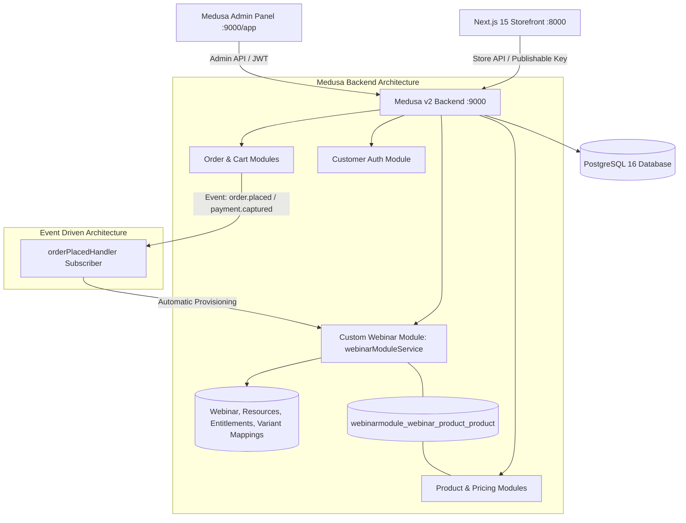

# Architecture Documentation: AcademyIO Webinar & Seminar E-Commerce Platform

## 1. System Overview

AcademyIO is a production-grade educational commerce system engineered using **Medusa.js v2** and **Next.js 15 (App Router)**. It provides end-to-end commerce capabilities for selling, licensing, and delivering digital webinars, masterclass seminars, on-demand video recordings, verbatim transcripts, and downloadable PDF study guides.



---

## 2. Technology Stack

- **Backend Framework**: Medusa.js v2 (`@medusajs/medusa` & `@medusajs/framework` v2.18.0)
- **Programming Language**: TypeScript (Strict typing enabled)
- **Primary Database**: PostgreSQL 16 (Relational models, link tables, foreign key constraints)
- **Storefront**: Next.js 15.3.9 with App Router and Server-Side Rendering (SSR)
- **UI & Styling**: Tailwind CSS, `@medusajs/ui`, `lucide-react`
- **Authentication**: Medusa JWT Customer Session and Bearer token verification
- **Payment Providers**: Medusa standard payment provider architecture (system test provider + Stripe support)

---

## 3. Custom Webinar Module (`webinarModuleService`)

The custom module is defined in `backend/src/modules/webinar` and registered in `medusa-config.ts`. It manages the domain logic for educational events and access entitlements.

### Data Models

#### A. `Webinar` (`models/webinar.ts`)
Represents an educational event or course offering:
- `id`: Unique identifier (prefix `web_`)
- `title`: Webinar title
- `slug`: SEO-optimized URL slug (unique)
- `short_description` & `description`: Formatted overview
- `featured_image`: Cover banner image
- `speaker_name`, `speaker_title`, `speaker_bio`, `speaker_photo`: Instructor credentials
- `event_date`, `start_time`, `end_time`, `timezone`, `duration_minutes`: Scheduling parameters
- `category`: Discipline classification (e.g. "Federal Taxation", "Auditing & Accounting")
- `cpe_credits`: Number of accredited CPE credits (0 to 4+)
- `is_upcoming`, `is_ondemand`, `is_seminar`, `is_featured`: Filtering flags
- `status`: Lifecycle status (`draft`, `published`, `archived`)
- `live_stream_url` & `live_instructions`: Private live session URL (e.g. Zoom/Teams)
- `live_link_published`: Boolean control ensuring links are only revealed when approved
- `recording_url` & `recording_expires_at`: High-definition video URL and expiration timestamp
- `transcript_content` & `transcript_file_url`: Written verbatim transcription
- `product_id`: Associated Medusa Product ID

#### B. `WebinarResource` (`models/webinar-resource.ts`)
Attached downloadable files:
- `id`: Resource ID (prefix `res_`)
- `title`, `description`, `file_name`, `file_size`, `file_type`
- `file_url`: Storage path or private cloud storage URL
- `access_type`: Required permission (`pdf`, `transcript`, `slides`, `handout`)
- `is_published`: Visibility switch

#### C. `CustomerEntitlement` (`models/customer-entitlement.ts`)
The core security and access record:
- `id`: Entitlement ID (prefix `ent_`)
- `customer_id`: Target customer identifier
- `customer_email`: Customer email for audit trail
- `order_id`: Commercial order ID linking financial transaction to access grant
- `order_item_id`: Specific line item purchased
- `variant_id` & `variant_title`: Specific purchasable variant
- `access_type`: Granted capability (`live`, `recording`, `transcript`, `pdf`, `bundle`)
- `status`: Access state (`active`, `revoked`, `expired`)
- `granted_at`, `expires_at`, `revoked_at`, `revocation_reason`

#### D. `WebinarVariantMapping` (`models/webinar-variant-mapping.ts`)
Maps a Medusa ProductVariant to its access capabilities:
- `variant_id`: Medusa Variant ID
- `option_type`: `live` | `recording` | `transcript` | `pdf` | `bundle`
- `includes_live`, `includes_recording`, `includes_transcript`, `includes_pdf`: Boolean permission matrix

---

## 4. Cross-Module Links

Medusa v2 uses module links rather than foreign keys across modular boundaries.
In `backend/src/links/webinar-product.ts`:
```typescript
import WebinarModule from "../modules/webinar"
import ProductModule from "@medusajs/medusa/product"
import { defineLink } from "@medusajs/framework/utils"

export default defineLink(
  WebinarModule.linkable.webinar,
  ProductModule.linkable.product
)
```
This generates the PostgreSQL table `webinarmodule_webinar_product_product`, preserving independence while enabling bidirectional graph queries.

---

## 5. Security & Access Control Architecture

1. **Information Redaction on Public Endpoints**:
   The public endpoint `GET /store/webinars` and `GET /store/webinars/:slug` explicitly strips:
   - `live_stream_url`
   - `live_instructions`
   - `recording_url`
   - `transcript_content`
   These fields are NEVER leaked in public responses.

2. **Server-Side Authentication**:
   In `backend/src/api/middlewares.ts`, `authenticate("customer", ["session", "bearer"])` protects all `/store/customer/*` routes. Unauthenticated requests are rejected with HTTP 401.

3. **Granular Entitlement Verification**:
   When an authenticated customer requests `GET /store/customer/webinars/:id/access`:
   - System queries active entitlements for `req.auth_context.actor_id` and the specified webinar.
   - If no active entitlement exists -> Returns HTTP 403 Forbidden.
   - If customer purchased **Live only** -> Returns live stream object (if published). Recording, transcript, and PDF objects are omitted.
   - If customer purchased **Recording only** -> Returns recording object. Live and transcript are omitted.
   - If customer purchased **Complete Package (Bundle)** -> Automatically unlocks all 4 content formats without duplicate purchases.

4. **Automated Event-Driven Provisioning**:
   The subscriber `backend/src/subscribers/order-placed.ts` listens for `order.placed` and `payment.captured`. It verifies variant mappings, ensures idempotency, and creates customer entitlement records in the database.
